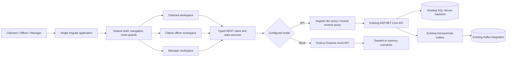

# Chubb APAC Claims Frontend
## Architecture and Backend Integration Plan

### 1. Goal and design position

Build a **separate Git repository** for one Angular application serving claimants, claims officers, and managers. The application must work in two explicit modes:

1. **API mode** — Angular calls the existing ASP.NET Core claims backend over REST using a real access token from the configured identity provider.
2. **Mock mode** — Angular calls a local Node.js/Express mock API that implements the same HTTP routes and DTO shapes, with seeded local scenarios and mock-only personas.

Use the real backend as the contract authority. The Node mock exists to support frontend development and a repeatable local walkthrough when the SQL Server, JWT issuer, or Kafka broker is unavailable. Do not build a second business backend, a frontend Kafka client, or an independent set of frontend-only routes.



The Angular client uses **REST only**. The backend already publishes integration events through its SQL transactional outbox to Kafka. No frontend screen should connect to Kafka directly. Because the backend has no push/notification endpoint, clients refresh data after commands and may poll visible status/detail views at a modest, configurable interval. Always show the last-refresh time when data may be stale; do not promise real-time updates.

### 2. Repository and technology choices

The frontend repository is separate from `chubb-apac-claims-backend`; never add Angular files to the backend repository. Suggested layout:

```text
src/
  app/
    core/                  # auth adapter, API configuration, interceptors, guards, shell
    shared/                # accessible controls, loading/error/empty states, status labels
    features/
      claimant/            # submit, list, tracking, request response, decision
      officer/             # queue, claim workbench, assignment, assessment, outcomes
      manager/             # workload, performance, exposure
  environments/            # public, non-secret feature/config values only
mock-api/
  src/                     # Node.js/Express routes, scenarios, mock auth, state transitions
contracts/
  backend-openapi-v1.json  # optional checked-in snapshot from backend /openapi/v1.json
docs/
  ...
```

Use a currently supported Angular release with TypeScript, standalone components, lazy feature routes, Angular `HttpClient`, RxJS for cancellable HTTP flows, and signals or a small feature-store service for local screen state. Do not introduce NgRx or a second state system without a concrete need. Keep forms reactive and typed. Use Node.js LTS and a small Express server for the mock; Express is more suitable than a static JSON file because this API has lifecycle transitions, ETags, role scope, paging, and structured errors. Pin versions in `package-lock.json`.

### 3. Single application for multiple user types

All roles load the same Angular bundle and shared shell, then see role-appropriate navigation and lazily loaded features:

| Persona | Main routes | Main tasks |
|---|---|---|
| Claimant | `/claimant/dashboard`, `/claimant/claims`, `/claimant/claims/new`, `/claimant/claims/:claimId` | Submit a motor/property claim, see own claims, track status/activity, respond to an open information request, see the outcome. |
| Claims officer | `/officer/queue`, `/officer/claims/:claimId` | Filter scoped queue, open workbench, assign, start/resume review, request information, assess/reserve, decide, add internal note, complete settlement workflow. |
| Manager | `/manager/overview`, `/manager/performance`, `/manager/exposure` | Review workload, ageing, decisions/settlements over a period, and exposure grouped by market/currency. |

Use `AuthService`/`AuthAdapter` as the single identity boundary. Role-based route guards and navigation are a usability layer; the backend remains authoritative and can return `401`, `403`, or `404`. Use a secure OIDC Authorization Code with PKCE adapter in API mode. The backend validates JWTs but does not provide a login UI, token endpoint, identity provider, or development token issuer. Do not invent a production identity system or hardcode tokens. Store access tokens only according to the chosen OIDC library's secure browser guidance; do not put credentials or tokens in source-controlled environment files.

In mock mode, provide an explicit local persona selector for claimant, officer, and manager scenarios. Send mock identity/scope only to the Node mock, using mock-only headers or an equivalent isolated mechanism. Never send mock headers or fake bearer tokens to the real API. Display a persistent “Demo data”/“Mock mode” indicator so nobody mistakes fixtures for claim records.

### 4. Data flow and state ownership

- Backend/Node API responses are the source of truth for claim data. Angular does not persist authoritative claims in local storage or duplicate business transitions in a client store.
- API services return typed observables. Feature pages own transient filter, selection, form, cursor, and pending-operation state. Cache only where it improves navigation and invalidate/refetch after every successful mutation.
- Cancel stale queue/report requests when filters change. Reset the opaque cursor whenever filters or page size change. Use the backend cursor for “Load more”/next-page interaction; do not fake page counts because responses have no total count.
- Read the response `ETag` header on detail/status GETs and send its exact quoted value as `If-Match` on each mutation. After success, replace it with the returned ETag and refresh the detail. On `409 Conflict`, stop the action, reload the claim, explain that another user changed it, and let the user retry deliberately. Never automatically replay a stale write.
- Disable submit/action buttons while a request is pending. The backend has no idempotency-key support. If a claim-submission POST times out after sending, show an “outcome unknown” state and first refresh the claimant claim list before inviting a resubmission; do not silently post again and create a duplicate.
- Map Problem Details and network failure into form-level, page-level, or banner messages. Preserve entered form data when server validation fails or the network is unavailable.
- Use optimistic updates only for simple local UI affordances; after any business mutation, trust the response and reload backend state.

### 5. Existing backend contract — use these exact routes

The checked-in backend runs on `http://localhost:5289` with the `http` launch profile (HTTPS profile also exposes `https://localhost:7038`). In Development it serves OpenAPI at `/openapi/v1.json` and Swagger UI at `/swagger`. Configure the actual API base URL through a local environment/proxy setting; do not hardcode the candidate project's `5187` address or put secrets in `environment.ts`.

All routes below are under `/api/v1`. Enums serialize as strings. Claim IDs are GUIDs; claim numbers are for display/search, not route keys.

#### Claimant routes

| Method and path | Contract / behavior |
|---|---|
| `POST /claims` | Body: `marketCode`, `lineOfBusiness` (`Motor`/`Property`), `contact { name,email,phone? }`, `incident { occurredAt,description }`, optional `reportedAt`, and exactly one of `motor` or `property`. Returns `claimId`, `claimNumber`, `status`, `version`; response includes ETag. |
| `GET /claims?pageSize=20&cursor=...` | Returns `{ items, nextCursor }`. Cards: `claimId`, `claimNumber`, `marketCode`, `lineOfBusiness`, `status`, `submittedAt`, `version`. Own claims only. |
| `GET /claims/{claimId}` | Claimant-safe detail: IDs/number, market/line/status, reported/submitted times, contact, incident, line-specific details, safe decision (type/date/optional amount; no decision reason), information requests, claimant-visible activities, version; response includes ETag. |
| `GET /claims/{claimId}/status` | Current status/number/submitted time; response includes ETag. |
| `GET /claims/{claimId}/timeline?pageSize=20&cursor=...` | Returns `{ items, nextCursor }` of claimant-visible history. |
| `POST /claims/{claimId}/information-requests/{requestId}/responses` | Body `{ responseText? }`; requires the latest `If-Match` ETag. Returns claim/request/status/version and a new ETag. Text limit is 4,000 characters. |

Motor detail fields accepted by the current submission DTO: `vehicleRegistration`, `make`, `model`, `modelYear`, `vehicleUse`, `drivable`, `otherPartyInvolved`. Property detail fields: `propertyType`, `addressLine1`, `addressLine2`, `city`, `region`, `postalCode`, `countryCode`, `lossCause`, `affectedAreaDescription`, `habitable`. Required fields and optional nullability follow the DTO and backend validation; do not require optional fields merely for visual completeness. The current submit DTO does **not** accept a policy number even though the database can store one.

#### Claims officer routes

| Method and path | Contract / behavior |
|---|---|
| `GET /staff/claims` | Scoped, cursor-paginated queue. Supported query names: `market`, `status` (one status), `teamId`, `officerId`, `submittedFrom`, `submittedTo`, `incidentFrom`, `incidentTo`, `claimNumber`, `pageSize` (1–100), `cursor`. Returns `{ items, nextCursor }`. |
| `GET /staff/claims/{claimId}` | Staff detail includes claimant/contact, incident and line details, current assignment, reserve, staff decision rationale, assessment history, reserve history, internal notes, activities, assignment history, version; response includes ETag. |
| `POST /staff/claims/{claimId}/assignment` | Body `{ teamId, officerSubjectId?, reason? }`; `If-Match` required. |
| `POST /staff/claims/{claimId}/review` | No body; `If-Match` required. ClaimsOfficer role. |
| `POST /staff/claims/{claimId}/information-requests` | Body `{ question }`; `If-Match` required. |
| `POST /staff/claims/{claimId}/resume-review` | No body; `If-Match` required. |
| `POST /staff/claims/{claimId}/assessments` | Body `{ assessmentType, rationale, recommendation?, reserveEstimate?: { amount,currency }, reserveReason? }`; `If-Match` required. |
| `POST /staff/claims/{claimId}/decision` | Body `{ type: Approved\|Rejected, reason, amount?: { amount,currency } }`; `If-Match` required. |
| `POST /staff/claims/{claimId}/internal-notes` | Body `{ noteText }`; `If-Match` required; staff-only. |
| `POST /staff/claims/{claimId}/settlement-workflow` | Body `{ amount?: { amount,currency }, reference? }`; `If-Match` required. Records workflow completion; it does not pay a claimant. |

Successful staff mutations return `{ claimId,claimNumber,status,version }` plus the new ETag. Staff APIs require JWT role plus team and market scope. Only expose team/officer assignment choices that are supplied in approved local configuration; the backend has no directory endpoint.

#### Manager routes

| Method and path | Contract / behavior |
|---|---|
| `GET /manager/workload` | Returns `asOfUtc`, groups by market/team/officer with status counts, unassigned count, ageing bands, and an `ageingDefinition`. No query parameters. |
| `GET /manager/performance?fromUtc=...&toUtc=...` | Returns interval, decision count, average/median decision elapsed days, missing-duration count, settlement count, average settlement elapsed days, missing-duration count. Require `fromUtc < toUtc`; backend range is `[fromUtc,toUtc)`. |
| `GET /manager/exposure` | Returns `asOfUtc`, groups by market/currency with amount and claim count, missing-reserve count, included statuses, and assumption text. Never add amounts across currencies. |

Manager data is scoped to the caller's team and market claims. Workload/exposure currently include `Submitted`, `InReview`, `Assessment`, `AwaitingInformation`, `Approved`, and exclude `Rejected`, `Settled`. Age bands are 0–7, 8–30, 31–90, 90+ elapsed UTC days since submission; these are not SLAs. Performance is operational throughput/duration, not a service commitment.

#### Platform and error contracts

- `GET /health` is an API health check; in Development `GET /openapi/v1.json` and `/swagger` document the backend.
- The API uses JWT roles `Claimant`, `ClaimsOfficer`, `Manager`; stable `sub`; staff `team`/`teams` and `market`/`markets` claims. A role route guard is not sufficient access control.
- Mutations require the current ETag via `If-Match`; ETag contains a version derived from SQL `rowversion`. Read it from response headers and preserve quotes exactly.
- Use server Problem Details for validation, access, missing resources, and conflicts. Handle `400`, `401`, `403`, `404`, `409`, and network/`5xx` states explicitly. The backend may return `404` for an unowned claimant resource to avoid revealing its existence.
- `pageSize` is 1–100 and `cursor` is opaque. There is no total count.
- Backend SQL/Kafka events do not expose a browser-facing event stream or notifications API. Refresh/poll using REST; never present Kafka as a UI connection.

### 6. Known backend limits the frontend must respect

The backend is complete for its defined claim workflow but does not currently expose:

- document upload/download, attachments, or binary storage routes — implement text-only additional-information response; do not show a fake working upload control;
- market catalog or market display-name endpoint — use an explicit environment configuration of the six approved market codes/names, and render a safe setup message if not configured; never invent codes;
- teams/officer directory — use approved local config for demo assignment choices, or show an actionable “assignment directory not configured” state; don't invent staff;
- policy lookup or policy coverage APIs — don't add policy fields to the submission form because the current POST DTO does not accept them;
- notification, WebSocket, SSE, or Kafka consumer endpoint — refresh data from REST and show last updated time;
- idempotency key support — guard against double-clicks and handle ambiguous timeout as described above;
- decision rationale in claimant DTO — show decision status/date/optional amount only, not staff rationale.

If a requested user journey depends on one of these, label it unavailable and link it to a backend extension request; never invent a client-only success state.

### 7. Candidate repository review

The public [insurance-claims-frontend repository](https://github.com/naeemabbas05/insurance-claims-frontend) is helpful as a **feature and presentation reference**. Its README describes separate claimant, officer, and management workspaces, typed API clients, reusable form controls, loading/error/empty feedback, and an accessibility/responsive focus. Those are useful ideas to carry into a fresh implementation.

It is **not a drop-in client for the current backend**. Its README documents routes such as `/api/v1/claims/{claimReference}/history`, `/api/v1/management/reports/...`, and settlement/attachment/notification paths that do not match the current backend (`claimId` GUIDs, `/timeline`, `/api/v1/manager/...`, no document or notification route). It also describes a dynamic form builder while the current API accepts fixed Motor/Property DTOs. The README itself notes unsupported backend capabilities and says it does not use a mock backend. Only the public README/repository listing was reviewed here; source-level behavior, build health, accessibility, and tests have not been independently verified. Use it for ideas, not endpoint assumptions or copy-paste integration.

### 8. UX priorities and edge cases

**Claimant priority:** short typed motor/property submission; confirmation with claim number and claim ID; personal claim list; clear status and event timeline; outstanding information request prominently visible; safe decision summary; preserve drafts during client validation/network errors. Do not expose staff-only notes/rationale.

**Officer priority:** compact scoped queue with market/status/team/officer/claim-number/date filters; unassigned and ageing visibility; claim detail with contact/incident/line facts; visible assignment and current status; step actions disabled when invalid or pending; request/response history; assessment and reserve rationale; approve/reject confirmation; settlement-workflow confirmation; internal notes visibly labeled staff-only. Always refresh detail before mutation and after a `409`.

**Manager priority:** current workload groups, ageing bands, date-bounded performance, and exposure by market and currency. Display `asOfUtc`, selected interval, missing-reserve count, and backend assumption text. Do not combine currencies, infer booked liability, show made-up SLAs, or compare against unsupported targets.

Cover at least these states: unauthenticated, expired token, wrong role, missing team/market scope, empty result, partial/null fields, malformed cursor, maximum page size, filters changing during fetch, slow/offline API, 400 field validation, 401 refresh/sign-in, 403 scoped denial, 404 removed/unowned claim, 409 stale ETag, server error, duplicate submit click, unknown submission outcome after timeout, ETag rotation after success, open/answered/cancelled information request, optional reserve absent, missing directory configuration, partial manager aggregates, mock reset, and API-vs-mock mode switch. All workflows need keyboard support, visible focus, semantic headings, field labels, useful error text, responsive layout, and adequate contrast.

### 9. Local configuration and run modes

Provide checked-in examples only (no tokens/secrets):

- Angular dev proxy `/api` to the configured backend URL; default to the backend's checked-in local HTTP profile `http://localhost:5289`, but allow a developer override.
- Angular mock mode points `/api` to Node mock API on a documented local port such as `http://localhost:4301`.
- API mode requires a configured backend URL and OIDC issuer/client settings; if the identity issuer is unavailable, explain login cannot be tested and switch to mock mode.
- Run scripts should support `npm run mock`, `npm start`, `npm run start:demo` (both) and `npm test`/build checks as implemented. Document startup order and how to reset mock fixtures.

Never add secrets to Angular environment files; they ship to the browser. Do not add Kafka to package dependencies for the frontend.

